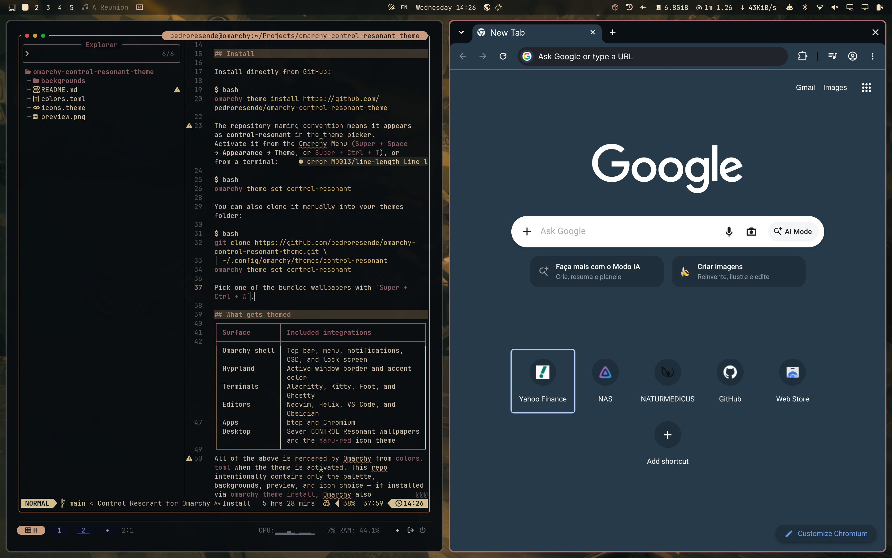

# Control Resonant for Omarchy

A cinematic dark theme inspired by **CONTROL Resonant**, with a near-black blue base, a warm parchment foreground, and a muted rose-red accent instead of bright neon. The palette was generated from the bundled wallpapers with [Aether](https://github.com/omacom/aether) for Omarchy v4, then carried across the shell, terminals, editors, and apps by Omarchy's theme engine.



## Why it stands out

- A deep `#0A0F13` background paired with a soft `#F8E1C3` foreground for comfortable, low-glare reading
- A single dusty rose accent (`#ac7077`) for active borders and UI highlights
- A warm, restrained ANSI ramp — amber, apricot, and muted red — rather than high-saturation colors
- Seven CONTROL Resonant wallpapers and a color-matched `Yaru-red` icon theme
- Palette-first design: this repo ships `colors.toml`, and Omarchy generates every app config from it on activation — there are no per-app files to keep in sync

## Install

Install directly from GitHub:

```bash
omarchy theme install https://github.com/pedroresende/omarchy-control-resonant-theme
```

The repository naming convention means it appears as **control-resonant** in the theme picker. Activate it from the Omarchy Menu (`Super + Space` → **Appearance → Theme**, or `Super + Ctrl + T`), or from a terminal:

```bash
omarchy theme set control-resonant
```

You can also clone it manually into your themes folder:

```bash
git clone https://github.com/pedroresende/omarchy-control-resonant-theme.git \
  ~/.config/omarchy/themes/control-resonant
omarchy theme set control-resonant
```

Pick one of the bundled wallpapers with `Super + Ctrl + W`.

## What gets themed

| Surface | Included integrations |
| --- | --- |
| Omarchy shell | Top bar, menu, notifications, OSD, and lock screen |
| Hyprland | Active window border and accent color |
| Terminals | Alacritty, Kitty, Foot, and Ghostty |
| Editors | Neovim, Helix, VS Code, and Obsidian |
| Apps | btop and Chromium |
| Desktop | Seven CONTROL Resonant wallpapers and the `Yaru-red` icon theme |

All of the above is rendered by Omarchy from `colors.toml` when the theme is activated. This repo intentionally contains only the palette, backgrounds, preview, and icon choice — if installed via `omarchy theme install`, Omarchy also regenerates any code-bearing files locally from the palette.

## Palette

| Role | Hex | Preview |
| --- | --- | --- |
| Background | `#0A0F13` |  |
| Dark background | `#080b0e` |  |
| Darker background | `#05080a` |  |
| Selection / lighter background | `#23272b` |  |
| Foreground | `#F8E1C3` |  |
| Dark foreground | `#baa992` |  |
| Light foreground | `#f9e6cc` |  |
| Bright foreground | `#fae9d2` |  |
| Muted | `#63686d` |  |
| Accent / blue | `#ac7077` |  |
| Red | `#be8b76` |  |
| Yellow | `#ffe7ad` |  |
| Orange | `#c89c8b` |  |
| Green | `#e9bd88` |  |
| Cyan | `#fed887` |  |
| Magenta | `#e4988f` |  |
| Brown | `#785e53` |  |

Bright ANSI variants: `#dd9d83` (red), `#ffe097` (yellow), `#ffd18b` (green), `#ffeb84` (cyan), `#cb8089` (blue), and `#ffa89c` (magenta).

## Customize

The theme is a plain folder of palette and image files — there is no build step. To tweak it, edit the relevant file directly:

- `colors.toml` — the semantic palette used to generate every themed config
- `icons.theme` — icon theme name (`Yaru-red` by default)
- `backgrounds/` — the seven bundled wallpapers; add or replace images here
- `preview.png` — thumbnail shown in Omarchy's theme picker
- `.aether-managed` — ownership marker for Aether/Omarchy; leave it in place

After editing, re-select the theme in **Appearance → Theme** (or run `omarchy theme set control-resonant`) to regenerate and reload the affected apps.

You can also load this palette into the Aether editor:

```bash
aether --import-colors-toml ~/.config/omarchy/themes/control-resonant/colors.toml \
  --wallpaper ~/.config/omarchy/themes/control-resonant/backgrounds/img2.jpg
```

## Credits

Palette generated from the CONTROL Resonant wallpapers with [Aether for Omarchy](https://github.com/omacom/aether). App configs are generated by [Omarchy](https://omarchy.org). CONTROL Resonant is a Remedy Entertainment game; wallpaper artwork belongs to its respective creators.
